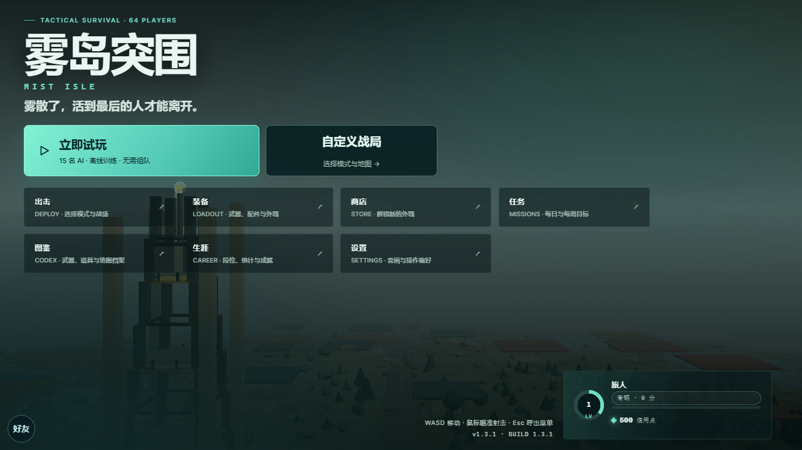

# 雾岛突围 / MIST ISLE

> 低多边形俯视角战术竞技：64 人空降雾岛，搜刮、交战、在五阶段风暴圈里活到最后。

原创美术、地图、程序化模型与合成音效；完全自研，未使用第三方游戏素材。
版本 **1.3.1** ｜ 协议 **v3** ｜ 平台 **Android 8.0+ / 现代浏览器（WebGL 2）** ｜ Node.js **≥ 22**

| 项目 | 值 |
| --- | --- |
| 当前版本 | `1.3.1`（`shared/rules.mjs` 的 `VERSION`） |
| 协议版本 | `3`（客户端与服务端必须一致，否则握手拒绝） |
| 服务端 Tick | `30 Hz`，每 3 tick 推一次快照（`10 Hz`） |
| 单场容量 | `64` 人 / `16` 队 × 4 人（`solo` 为 64 队 × 1 人） |
| 运行依赖 | `three@0.180.0`、`ws@8.22.0`、`lucide@1.53.0` |
| 构建/测试依赖 | `esbuild@0.28.2`、`@playwright/test@1.64.0` |

---

## 游戏截图



[查看手机横屏界面](docs/screenshots/home-mobile.png)

## 特性

- **3 张程序化地图**：青岚岛（海／阵雨／白昼）、赤砂矿区（沙丘／沙暴／黄昏）、白夜港（冰／落雪／长夜）。地形、建筑、道路、障碍、物资点、出生锚点全部由 `shared/map.mjs` 按种子生成，三图几何签名互不相同（建筑/障碍/树：78/2011/960、72/1956/936、84/1848/938）。
- **18 把武器 / 8 个类别**：手枪、冲锋枪、突击步枪、霰弹枪、精准步枪、狙击枪、机枪、特种；每把都有独立的伤害、射速、弹匣、装填、射程、散布、后坐、枪声暴露半径与移速倍率。
- **14 个配件 / 4 个槽位**：瞄具（optic）、枪口（muzzle）、弹匣（mag）、握把（grip）；按槽位互斥，实时合成出「有效属性」，不修改原始数据。
- **4 种模式**：单人生存 `solo`、四人小队 `squad`、生存波次 `horde`、训练场 `training`（离线可玩）。
- **64 人同场**：16 支小队共享一张地图；真人席位优先，开局时其余空位由 AI 补齐。
- **5 阶段风暴圈**：等待 30/24/20/16/12 秒、收缩 26/24/22/18/16 秒、半径比例 0.72/0.52/0.34/0.19/0.075、圈内伤害 5/9/14/20/28 每秒；首次等待 `ZONE_FIRST_WAIT = 30` 秒。
- **4 种载具**：沙滩越野（4 座／15.5 m/s／220 HP）、军用吉普（4 座／13.5／320）、越野摩托（2 座／18.5／130）、运输卡车（6 座／11.2／440）。同车乘员可开火，撞击与爆炸都会造成伤害。
- **空投**：开局 45 秒后首次投放（训练场 60 秒），之后每 75 秒一次，全场 3 个（训练场 1 个）；降落 12 秒，开箱产出 3–4 件高品质物资。
- **降落区投票**：房间等待阶段在战术地图上选点，全队 ping 实时同步；开局时小队出生锚点自动贴近投票质心（协议 v3 增量字段，旧服务器优雅降级）。
- **要害命中**：命中弹道经过目标中心核心区（`COMBAT.headshotCoreRatio = 0.38`）时伤害 × 武器 `headshotMul`（1.4–2.2），要害任务与成就全部可达。
- **复活与倒地**：小队模式致命伤转为倒地，30 秒失血；队友持续交互 4.5 秒可救起（回复 42 HP）。生存波次模式下阵亡 8 秒后于基地复活。
- **进度系统**：60 级经验曲线（合计 95,044 XP）、7 大段位、每日 28 条任务池／每周 20 条任务池（每日取 6 条、每周取 4 条）、48 项成就（含 5 项隐藏）、68 件商店外观（22 角色皮肤 + 26 武器皮肤 + 20 其他）。
- **离线复用同一套规则**：训练场在浏览器与 APK 内直接跑 `shared/simulation.mjs` 的 `Match`，与服务器使用完全相同的命中、缩圈、载具、AI 代码。

---

## 试玩与发布状态

- **一键试玩**：主菜单点「立即试玩」，不注册、不建房，直接进入 15 名 AI 的离线训练场。
- **自定义战局**：可选择单人生存、四人小队、生存波次与训练场，另有三张地图、三档 AI 难度。
- **[浏览器在线试玩](https://tbj0623.github.io/mist-isle/)**：GitHub Pages 静态客户端，支持离线模式；**不包含公网多人服务器**。多人联机需要自行部署下方 Node.js 服务端。
- **[Android APK 下载](https://github.com/tbj0623/mist-isle/releases/tag/v1.3.1)**：v1.3.1 正式签名测试版，Android 8.0+；正式商店上架、跨机型兼容与公网服务仍在验证中。
- **开源许可**：项目原创代码与可分发原创素材以 [MIT](LICENSE) 协议开放。第三方依赖各自保留许可，见 [THIRD_PARTY_NOTICES.md](THIRD_PARTY_NOTICES.md)。
- **测试版声明**：本仓库有自动化测试，但尚未经过大规模真人对局、公网弱网和多台 Android 真机完整验收。欢迎通过 Issues 报告可复现问题。

## 快速开始

```powershell
npm install
npm run build
npm start
```

打开 `http://127.0.0.1:8787`（`PORT` 默认 `8787`，`HOST` 默认 `0.0.0.0`）。健康检查：`GET /health` 返回版本、协议与房间数。

- `npm run dev` = `build` + `start`，改完客户端不需要手动再 build。
- 修改 `shared/` 或 `server/` 后必须重启进程；修改 `client/` 后必须重新 `npm run build` 并刷新页面。
- `dist/` 由 `scripts/build.mjs` 用 esbuild 打包 `client/main.js`，并复制 `index.html`、`style.css`、`icon.svg` 与三份许可证；同一份产物会被同步到 `android/app/src/main/assets/`。

## 构建 Android

```powershell
npm run android
```

脚本先执行 Web 构建，再定位 Android SDK（`ANDROID_HOME` → `ANDROID_SDK_ROOT` → `%LOCALAPPDATA%\Android\Sdk`）与 Gradle 8.14.3，最后 `assembleDebug` 并把 APK 复制为：

```
artifacts/mist-isle-<version>-debug.apk   →   artifacts/mist-isle-1.1.0-debug.apk
```

包名 `com.mistisle.game`，`minSdk 26`（Android 8.0）、`targetSdk 36`、`versionCode 110`。壳是原生 `WebView` + `WebViewAssetLoader`（资源走 `https://appassets.androidplatform.net/assets/`），关闭文件与内容访问，不暴露原生 JS 桥。自适应启动图标（VectorDrawable 前景 + Android 13 单色图标）。`android/keystore.properties` 存在时 `assembleRelease` 自动启用正式签名 + R8 混淆 + 资源收缩（release 包约 0.5 MB），否则回退 debug 签名并打印警告；构建脚本会校验 `package.json` 与 `build.gradle` 版本一致。

## 操作

| 动作 | 桌面 | 触屏 |
| --- | --- | --- |
| 移动 | `W` `A` `S` `D` | 左摇杆 |
| 瞄准 / 开火 | 鼠标移动 / 鼠标左键 | 右摇杆拖动（可开自动开火） |
| 换弹 | `R` | 换弹按钮 |
| 加速跑 | 按住 `Shift` | 冲刺按钮 |
| 蹲下 | 按住 `Ctrl`（或按 `C` 切换） | 蹲伏按钮 |
| 翻滚 | `空格` | 翻滚按钮 |
| 交互（拾取／上车／开空投／救援） | 按住 `E` | 交互按钮（救援需长按） |
| 计分板 | 按住 `Tab` | 计分板按钮 |
| 切枪 | `1` / `2`（`Q` 快速切换） | 武器槽按钮 |
| 投掷物 | `G`（`F` 轮换投掷物） | 投掷按钮 |
| 治疗 | `H` | 治疗按钮 |
| 地图 / 背包 | `M` / `B` | 地图 / 背包按钮 |

## 项目结构

```
qiusheng/
├─ shared/                 同构层（Node 与浏览器共用，禁止 DOM/Node API）
│  ├─ rules.mjs           ★ 全部数值常量（冻结）
│  ├─ simulation.mjs      Match：权威模拟、快照、缩圈、载具、波次
│  ├─ map.mjs             程序化世界生成 + 碰撞/射线/导航
│  ├─ ai.mjs              thinkBot：Bot 战术决策
│  ├─ progression.mjs     XP/等级/段位/奖励/任务进度
│  └─ data/               maps / weapons / items / loot / missions /
│                         achievements / store / ranks / bots
├─ server/index.mjs       房间、协议 v3、静态资源、速率限制
├─ client/                main / scene / models / fx / ui-hud /
│                         ui-screens / input / net / audio / meta
├─ android/               Gradle 工程 + WebView 壳（MainActivity.java）
├─ scripts/               build.mjs、build-android.ps1、benchmark.mjs…
├─ tests/                 node --test 单测 + Playwright e2e
├─ docs/                  CONTRACTS / DESIGN / GAMEDESIGN / CONTENT / ACCEPTANCE
└─ artifacts/             构建产物、截图、压测报告
```

## 架构

**服务端权威 + 客户端只发输入。** `server/index.mjs` 用累加器以固定 30 Hz 调用 `Match.update(1 / TICK_RATE)`，每 3 tick（10 Hz）生成一次按可见性裁剪的快照。客户端 `client/net.js` 只上传 `{mx, mz, aim, fire, reload, …}` 这类输入帧，位置、生命、伤害、弹药、缩圈与掉落全部由服务端计算。

- **本地预测**：`client/scene.js` 的 `predictInput(input, dt)` 在本地先行推进本机角色，服务端快照到达后做平滑纠正（位置按 `1 - e^(-13·dt)` 逼近）；远端角色同样按指数平滑插值，避免 10 Hz 快照造成跳帧。
- **同构**：`shared/` 是唯一事实来源。服务器、浏览器、离线训练场和三份测试都 `import` 同一批模块；`tests/world.test.mjs` 会静态检查共享层不出现 `Math.random`、DOM 与 Node API。
- **离线复用 `Match`**：`client/main.js` 的 `buildOfflineMatch()` 直接 `new Match(...)`，训练场与 APK 内置模式走的是和联机完全一致的模拟核心，不需要第二套逻辑。
- **协议 v3**：握手时校验 `PROTOCOL_VERSION`，不一致直接拒绝；房间码 + 重连 token，断线保留身份 20 秒。
- **二进制快照（wire v1，1.2.0 增量）**：握手时协商 `binary:true`，成功后 `state` 帧改为二进制（控制消息仍是 JSON）。静态字段（`id/name/bot/team/teamName`）走一次性 `roster`，之后只发 1 字节槽位；玩家/载具/战利品/事件按「位掩码 + 默认值省缺」编码，位置量化 0.05m、角度 1/65536 圈；服务端把与观察者无关的区块（车辆/事件/空投/horde）只编码一次给全房复用。实测 64 人快照 **6.76 KB → 418 B（-93.8%）**，单房间下行 **34.6 → 2.14 Mbps**。老客户端不传 `binary` 时行为与 1.1.0 完全一致；服务端 `WIRE_BINARY=0` 可整体回退。详见 [docs/CONTRACTS.md §4.1](docs/CONTRACTS.md)。
- **确定性**：模拟只使用 `Match.rng()`（mulberry32 种子随机），不用 `Math.random`，相同 seed 的两局在相同 tick 后状态一致（已有测试覆盖）。

## 战斗与移动速查

| 参数 | 值 | 来源 |
| --- | --- | --- |
| 步行 / 冲刺 / 蹲伏 | 6.2 / 8.9 / 3.4 m/s | `MOVE.walk` `MOVE.sprint` `MOVE.crouch` |
| 倒地爬行 | 2.2 m/s | `MOVE.downed` |
| 翻滚 | 4.3 m 位移 / 0.26 s / 1.9 s 冷却 | `MOVE.dodgeDistance` 等 |
| 水中移速 | 陆地 × 0.55 | `MOVE.waterMul` |
| 冲刺耐力 | 上限 100、消耗 22/s、回复 15/s、低于 12 无法起跑 | `MOVE.sprint*` |
| 生命 / 护甲 / 护盾 | 100 / 上限 150 / 上限 100 | `COMBAT` |
| 爆头倍率 | × 1.8（武器可覆写 1.4–2.2） | `COMBAT.headshotMul` |
| 倒地受伤 | × 1.35 | `COMBAT.downedDamageMul` |
| 伤害衰减 | 超过射程 55% 开始衰减，末端保留 28% | `COMBAT.damageFalloffStart/End` |
| 护甲吸收 | 轻/制式/重甲 35% / 45% / 55%，耐久 60/100/150 | `ARMORS` |
| 复活 / 失血 | 4.5 s 交互 / 30 s 倒计时 / 回复 42 HP | `REVIVE_*` |

实际衰减按每把武器的 `falloff.start/keep` 计算，例如 AWM 在 95% 射程仍保留 89% 伤害，而 Vector 只剩 30%。

## 画质与设置

`QUALITY` 提供三档预设（`low` / `balanced` / `high`），分别控制像素比 0.75/1.2/2、阴影开关、特效强度 0.5/1/1.4、可视距离 78/96/118 米与水面反射。设置项还包括瞄准灵敏度、摇杆大小（0.7–1.5）、自动开火、震动反馈、左手/右手布局、HUD 缩放（70%–130%）、显示帧率与「减少动态效果」。设置写入 `localStorage`，刷新与重开应用后保留。

局内只读诊断入口：`window.mistIsle.getState()` 返回服务端快照，`window.mistIsle.getStatus()` 返回帧率、绘制调用与几何体/纹理计数。二者都不提供修改服务端状态的接口。

## 存档与进度

`client/meta.js` + `shared/progression.mjs` 负责本地存档（键 `mist-isle-save-v1`，`SAVE_VERSION = 2`），内容包括等级与经验、信用点、段位分、任务进度、成就、已购外观与装备槽。结算流程：`Match` 结束 → `matchSummaryFromState()` 生成摘要 → `Meta.addMatchResult()` 计算 XP、信用点与 rating 变化 → 写入本地存档。存档损坏时回退到空白档，`import`/`export` 往返一致（有测试覆盖）。

## 项目约定

- 单位统一：位置/距离为米，时间为秒，角度为弧度（`0` 指向 `+Z`，`x 分量 = sin(angle)`）。
- 缩进 2 空格、单引号、行尾分号、ESM（`.mjs` / `"type": "module"`）。
- `shared/` 里不允许出现 `window`、`document` 与 Node 专属 API；随机只用种子 PRNG。
- 文案直接写中文，界面不出现「开发中 / 原型 / TODO」占位（`tests/ui-static.test.mjs` 会检查）。

## 常见问题

| 现象 | 处理 |
| --- | --- |
| 打开页面白屏 | 先跑 `npm run build`；`dist/` 缺失时服务端只有 API 可用 |
| 连不上房间 | 检查协议版本提示；客户端与服务端 `PROTOCOL_VERSION` 必须都是 `3` |
| 抓包看到二进制帧 | 1.2.0 起 `state` 走二进制（wire v1）。服务端 `WIRE_BINARY=0`、或客户端 `new NetClient({ wantBinary:false })` 可回退纯 JSON |
| 手机连不上电脑 | 手机与电脑需同一网段，Windows 防火墙放行 TCP 8787；模拟器用 `ws://10.0.2.2:8787` |
| 帧率偏低 | 设置里切到「流畅」画质，关闭阴影与水面反射，降低可视距离 |
| APK 构建失败 | 需要 JDK 17、Android SDK 36、Gradle 8.14.3，并设置 `ANDROID_HOME` |

## 性能预算与实测

| 指标 | 预算 / 实测 | 来源 |
| --- | --- | --- |
| 服务端单 tick | 预算 33.33 ms（30 Hz） | `TICK_RATE` |
| 64 人模拟 tick P50 / P95 | 0.107 ms / 0.383 ms | `artifacts/benchmark.json`（1.1.0） |
| 64 人模拟 tick P99 / 最大 | 0.630 ms / 8.741 ms | 同上 |
| 4 房间 × 64 并发 tick P99 / 最大 | 0.457 ms / 1.417 ms | 同上（房间间无互相拖慢） |
| 快照生成耗时（64 成员/轮） | P50 约 1.0 ms（较 1.0.0 -40%） | 受控 A/B |
| 快照体积（64 人、10Hz、含 lootPatch） | JSON 6.76 KB → 二进制 **418 B**（-93.8%，p95 455 B） | `artifacts/wire-benchmark.json` |
| 单房间下行（64 观察者） | JSON 34.6 Mbps → 二进制 **2.14 Mbps** | 同上 |
| 真实 WebSocket A/B（8 s 稳态） | 每人 785.9 KB → **49.2 KB**（-93.7%） | 同上 `live` 段 |
| 快照序列化（64 帧/轮） | JSON 3.5 ms → 二进制 **1.7 ms**；解码 ≈ 0.07 ms/帧 | 同上 |
| 新玩家首帧 | JSON 21.0 KB → 二进制 **1.93 KB**（roster 一次性 5.15 KB） | 同上 |
| 三场整局 tick 总数 | 16,625 | 同上 |
| 64 条本机 WebSocket | 8.2 s 内 116 次快照/连接，0 协议错误 | 同上 |
| 长稳（连续对局 ≥26 模拟分钟） | **观察级**：修复 AI 目击表泄漏后斜率 1.86 → **0.84 MiB/模拟分钟**（-55%），R² 0.59 → 0.14（不再是线性累积，转为 V8 热身扩张）；tick 分位无劣化 | 本机复测 |
| 客户端绘制调用 / 三角面 | 目标 < 220 / < 260k | `docs/CONTRACTS.md` |
| 客户端画质档 | 低 0.75x / 均衡 1.2x / 高 2x 像素比 | `QUALITY` |

以上为**本机合成负载**，不代表 64 台真机、公网延迟或发热表现。1.0.0 记录的 P99 28.7 ms / 最大 172 ms GC 尖峰已在 1.1.0 通过快照共享基座 + 对象复用 + loot 压实治理（P99 -82%、max -75%），并用「3 图 × 600 tick × 4 观察者快照逐字节一致」证明行为不变。

## 1.3.0 的范围边界

1.3.0 补上了 1.x 一直缺的两个战术系统：

- **自由航线 + 完整跳伞**（`deployStyle: 'skydive'`）：运输机横穿地图，可跳窗口内主动跳伞，
  自由落体 → 自动开伞 → 滑翔落地，空中可用瞄准方向选落点。**默认关闭**（联机房间仍是
  「落地即开打」），房主在等待室一键切换，或设 `DEPLOY_STYLE=skydive` 让新房间默认跳伞。
- **AI 听觉**：枪声按 `78m × weapon.noise` 传播，AI 在无目击情报时朝声源摸过去。
  这让消音器从「伤害更低的装饰」变成真实的战术取舍（AR7 可听半径 66m → 35m）。

仍然**没有**：语音队聊（文字聊天可用）、账号体系与云存档、跨局好友、生产级匹配与反作弊、
商店上架合规、多台真机长时间温控验证。验收状态见 [docs/ACCEPTANCE.md](docs/ACCEPTANCE.md)。

## 测试

```powershell
npm test                    # node --test tests/*.test.mjs（当前 343 项，约 45 秒）
npm run test:coverage       # 同上 + 覆盖率文本表 + coverage/lcov.info
npm run test:e2e            # Playwright（需先 npx playwright install chromium）
npm run benchmark           # 三场 64 角色模拟 + 64 条本机 WebSocket
npm run benchmark:wire      # JSON vs 二进制快照的体积/耗时对比 → artifacts/wire-benchmark.json
npm run lint                # oxlint 全仓库静态检查
npm run format:check        # Prettier 格式检查（只校验新增/已纳入的文件，见下文）
npm run precommit           # 提交前快速自检（lint + 2 个测试文件，约 4 秒）
```

`npm test` 覆盖数据表一致性、世界生成与碰撞、模拟核心（含要害命中与 loot 压实）、进度系统、服务端房间与重连（含停机/落盘/防滥用）、AI 行为与确定性、UI 静态约束。当前基线：**343 项全部通过**（1.3.0 新增 `deploy.test.mjs` 16 项覆盖航线/跳伞三阶段/落点安全/确定性/向后兼容，`hearing.test.mjs` 8 项覆盖枪声半径/消音器/TTL/表大小上限；文件为 data / world / simulation / deploy / hearing / ai / progression / mastery / season / replay / social / telemetry / server / server-hardening / ui-static / render-static）。

e2e 共 **12** 项（`tests/e2e/`）：**桌面**覆盖首屏加载、出击→模式选择→训练场开局、键鼠移动/开火/换弹/暂停/返回、装备/商店/任务/图鉴/生涯/设置六个界面、命中反馈与击杀信息流、弹药打空警告；**移动端**覆盖 844×390 横屏触控层（双摇杆位置、拖动摇杆产生位移、非纯色画布）与 390×844 竖屏可加载/旋转恢复；**四人小队**用真实 WebSocket 队友跑房间→加载→救援长按→同车乘客射击→标记→结算，以及联机主循环回归；**降落区投票**覆盖投票→开局出生点贴近投票锚点。压测与长稳报告写入 `artifacts/benchmark.json` 与 `artifacts/soak-summary.md`，明确标注为**本机合成连接**，不代表 64 台真机或公网。

### 代码质量工具链

| 工具 | 配置 | 说明 |
| --- | --- | --- |
| **oxlint** | `.oxlintrc.json` | Rust 实现的 linter，全仓扫描约 1–5 秒。真实 bug 级规则（`no-undef` / `no-unreachable` / `no-debugger` / `no-eval` / `no-dupe-keys` / `eqeqeq`）为 **error**；整洁度规则（`no-unused-vars` / `no-unused-expressions`）为 **warn**，不阻塞合并。生产代码里 `console.log` 会警告，`warn/error/info` 放行。 |
| **Prettier** | `.prettierrc.json` + `.prettierignore` | 2 空格 / 单引号 / 分号 / 120 列 / `trailingComma: all`。**只约束新文件**：存量手写代码（大量对齐注释）被列进 `.prettierignore` 冻结，全量格式化约 2.8 万行 diff，收益不足以抵消 review 成本。新文件自动纳入 `format:check`；想逐步收敛时，从 ignore 清单删掉对应行再 `npm run format`。 |
| **覆盖率** | `scripts/coverage.mjs` | Node 内置 `--experimental-test-coverage`，无额外依赖，输出文本表 + `coverage/lcov.info`。 |
| **CI** | `.github/workflows/ci.yml` | push/PR 触发；Node 22 + 24 矩阵跑 `build → lint → test → coverage`；e2e（Playwright/chromium）独立 job，允许失败但上传 trace/截图。`CI=true` 时 `tests/perf-budget.mjs` 把计时断言预算放宽 3 倍（本地保持 1 倍，断言不削弱）。 |
| **依赖更新** | `.github/dependabot.yml` | npm 与 Actions 每周分组提 PR；`three` / `lucide` 只收 patch（minor 可能改变渲染与图标语义）。 |

**格式化取舍的依据**：`prettier --list-different` 显示 135 个代码文件里 133 个不满足默认规则，
全量格式化会产生约 2.8 万行变更（约等于源码 1/4），且会拆散 `rules.mjs` 里成排的紧凑数值表。
按任务约定「差异巨大 → 不改存量代码」，最终选择 `--check` 只对新增文件生效，同时把 `npm run format` 留给单独一次「格式化专项提交」。

### 提交前检查

不装 husky，用一个纯 Node 脚本 `scripts/precommit.mjs`（约 4 秒），逻辑是 `oxlint` + `node --test tests/render-static.test.mjs tests/data.test.mjs`：

```powershell
npm run precommit                     # 手动跑

git config core.hooksPath .githooks   # 或装成 git hook（一次配置，全仓库生效）
```

脚本对 `error` 级 lint 与测试失败返回非零退出码，`git commit` 会被拦下；确实要跳过时 `git commit --no-verify`。
完整测试（当前 343 项，约 45 秒）与 e2e 交给 CI，不放在 pre-commit 里。

### 覆盖率基线（2026-10-29 · Node 24.20 · `npm run test:coverage`）

| 范围 | 行 | 分支 | 函数 |
| --- | --- | --- | --- |
| 全部（含无单测覆盖的 UI 渲染层） | 65.92% | 79.37% | 60.32% |
| **核心（`shared/` + `server/`）** | **85.39%** | **79.61%** | **74.40%** |
| `shared/` | 84.95% | 82.00% | 71.60% |
| `server/` | 87.53% | 70.67% | 83.08% |
| `client/` | 25.70% | 77.72% | 26.80% |

> 测量时仓库里有并行开发正在合入（`shared/wire.mjs` 是刚加入的 2350 行二进制快照编解码）。
> 只看工具链接入那一刻的基线：全部 67.37% / 核心 91.24%。新增文件把核心拉低到 85.39%——
> 这也正是把覆盖率写进 CI 的意义：新代码一进来就能看到它缺多少测试。

`client/ui-hud.js`（≈12%）与 `client/ui-screens.js`（≈12%）是拖低总分的两个大文件——它们是纯 DOM 渲染层，
单测只做静态约束（`tests/ui-static.test.mjs`），真实交互由 Playwright e2e 覆盖，因此**不计入**「必须补单测」清单。

**必须补测试的核心模块**（核心层行覆盖 < 90% 或分支覆盖 < 70%）：

1. `shared/wire.mjs` — **52.30% 行**（分支 95.12%），新增的二进制快照编解码；`tests/wire.test.mjs` 还没落地，这是当前最大的空白。
2. `shared/horde.mjs` — 63.02% 行 / 64.20% 分支；波次生成、基地血量、10 种升级、波次修正只被 `npm run horde:sim` 脚本跑过，没有断言级单测。
3. `server/http.mjs` — 76.92% 行 / 56.52% 分支；未覆盖的是 404/405、超大 body、畸形 URL 等错误分支。
4. `shared/telemetry.mjs` — 84.97% 行 / 64.15% 分支；未覆盖集中在 `analyzeMatches` 的空数据/异常行路径与 `percentile` 边界。
5. `server/actions.mjs`（85.22%）— 非法动作与房间销毁的分支路径。
6. `server/social.mjs`（89.65% / 61.29% 分支）— 好友/邀请的失败分支。
7. `server/guard.mjs`（82.55% / 80.00% 分支）— 令牌桶与来源白名单的拒绝路径。
8. `shared/data/enemies.mjs` 分支 39.29%：数据表只有少量生成函数，被 horde 测试间接覆盖；补 `horde.mjs` 时一并覆盖。
9. `shared/progression.mjs` 分支 62.17%（行覆盖 96%）— 任务/成就的边界条件（空池、重复进度）缺分支用例。

> 注：`server/telemetry.mjs`、`server/index.mjs` 的行覆盖已达 87–94%，剩余的未覆盖行主要是信号处理（`SIGINT`/`SIGTERM`）
> 与进程级异常兜底，单测里不值得去 mock 进程退出，可不追求。

## 文档索引

| 文档 | 内容 |
| --- | --- |
| [docs/GAMEDESIGN.md](docs/GAMEDESIGN.md) | 设计支柱、核心循环、战斗/移动/缩圈数值、经济与进度模型 |
| [docs/CONTENT.md](docs/CONTENT.md) | 地图、武器、配件、道具、载具、模式、任务、成就、商店、段位全表 |
| [docs/ACCEPTANCE.md](docs/ACCEPTANCE.md) | 分模块可勾选验收清单（只勾选代码或 `tests/` 可确认项） |
| [docs/CONTRACTS.md](docs/CONTRACTS.md) | 并行开发契约：文件归属、数据结构、DOM id、协议字段 |
| [docs/DESIGN.md](docs/DESIGN.md) | 视觉设计规范：色彩/间距/字号 Token、HUD 布局、断点 |
| [CHANGELOG.md](CHANGELOG.md) | 1.0.0 变更记录（Keep a Changelog 中文版） |

## 部署

`Dockerfile` 提供单进程镜像；`deploy/Caddyfile.example` 是 WSS/HTTPS 反代示例（未实际部署）。

```sh
docker build -t mist-isle .
docker run --rm -p 8787:8787 --name mist-isle mist-isle
```

运维与数据：`GET /stats` 返回 uptime、内存、房间/连接数与 tick 分位；对局结束自动追加到 `data/matches.jsonl`；设置 `TLS_CERT`+`TLS_KEY` 可直接启用原生 WSS（或用 `deploy/Caddyfile.example` 反代终止 TLS，二选一）；`ALLOWED_ORIGINS` 限制允许的来源。房间运行态仍在进程内存中，重启即丢失（对局结果除外）。

## 第三方许可

| 依赖 | 版本 | 许可 |
| --- | --- | --- |
| three | 0.180.0 | MIT |
| ws | 8.22.0 | MIT |
| lucide | 1.53.0 | ISC |
| androidx.webkit | 1.14.0 | Apache-2.0 |

许可证随构建复制到 `dist/licenses/` 与 APK 资源中，详见 [THIRD_PARTY_NOTICES.md](THIRD_PARTY_NOTICES.md)。开发工具为 esbuild 与 Playwright，不进入运行时产物。
